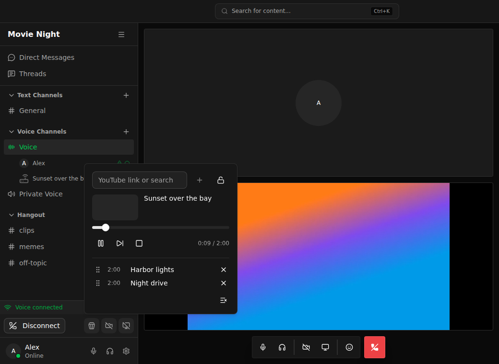

# Jollyvideo

Watch YouTube together in Sharkord voice channels.



## Install

1. Download `jollyvideo-<version>.zip` from [Releases](https://github.com/innovativefluid/jollyvideo/releases/latest).
2. Unpack it into Sharkord's `plugins` folder (`~/.config/sharkord/plugins`, in Docker `/home/bun/.config/sharkord/plugins`) and restart Sharkord.
3. Turn it on under Server settings → Plugins.

On first start the server downloads yt-dlp and ffmpeg, checked against their SHA-256.

## Use

Join a voice channel and click the popcorn button next to the camera button. Paste a YouTube video, playlist or livestream link, or type a search. A video starts once its first 20 seconds have downloaded.

Drag queued videos to reorder them. Moderators (*Move members*) can lock the player so only they control it.

Commands: `/watch`, `/watch-skip`, `/watch-stop`, `/watch-lock`, `/watch-update`.

## Settings

Video quality (480p to 1080p, 30 or 60 fps), longest video, videos at once across the server, and weekly yt-dlp updates. A 720p60 video keeps about half a CPU core busy, 1080p60 about one.

If YouTube asks the server to sign in, put a `cookies.txt` into `plugin-data/jollyvideo/bin` in Sharkord's folder. Take it from a spare Google account: everyone's searches and videos go through it, private ones included.

## Development

```sh
bun install
bun run sharkord   # Sharkord's source, for the class check, preview and end-to-end test
bun run check
bun run test       # also test:media, test:e2e
bun run build
bun run preview    # the panel with Sharkord's styles, without a server
```

Releases: Actions → Release → Run workflow.

## License

MIT
